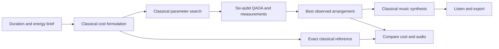

# QubitMusic

### Adaptive instrumental soundtracks with quantum + classical computing

**Turn a duration and energy brief into a short instrumental cue. Generate, listen, compare and export—all in an interactive studio.**

Built for the Qollab Quantum Hackathon's **Quantum Impact** theme: solving real-world problems with quantum + classical computing.

[Português do Brasil](docs/README.pt-BR.md) · [Português de Portugal](docs/README.pt-PT.md) · [Español](docs/README.es.md)

**Quick links:** [Get started](#quick-start) · [Quantum model](#the-quantum-model) · [Qollab](#run-on-qollab) · [Vercel](#deploy-on-vercel) · [Validation](#validation-and-project-status) · [Troubleshooting](#troubleshooting)

> **Prototype status:** the browser studio and local Qiskit implementation have been tested. Execution and publication inside Qollab, remote IonQ execution and the public Vercel deployment still require verification. No quantum advantage or measured user benefit is claimed.

## Why this project exists

A teacher needs a gentle cue for a 24-second lesson introduction. A small creator needs background audio that fits a 30-second story. An indie developer needs a short, energetic game cue.

Finding an appropriate recording, checking its usage terms and editing it to the right length adds work. QubitMusic explores a simpler workflow: describe a few useful constraints, generate instrumental audio and export a WAV for an editor or game engine.

The intended impact is **making soundtrack creation more accessible to people with limited time, tools or music-production experience**. This is a proposed benefit, not a result established through user studies.

Quantum computing participates in selecting a section arrangement. Classical computing handles the brief, circuit tuning, result evaluation, note composition and audio generation.

## Features

| Feature | Current behavior |
| --- | --- |
| Use-case presets | Lesson, story/video and indie game starting points |
| Duration | 8–60 seconds |
| Energy | Target energy from 0% to 100% |
| Sound palette | Warm, glass and pulse timbres |
| Musical key | C, D, F or A |
| Variation seed | Control procedural notes; remix increments the seed |
| Visualization | Notes and six gentle/energetic sections |
| Playback | Play, stop and listening volume |
| WAV export | Mono, 22,050 Hz, 16-bit PCM audio |
| JSON export | Notes, settings, arrangement and optimization results |
| Classical comparison | Hear the exact optimum using the same synthesis settings |
| Quantum details | Circuit parameters, measurement histogram, cost and solution gap |
| Languages | English, Brazilian Portuguese, European Portuguese and Spanish |

This version produces **short instrumental cues**. It does not generate lyrics, vocals, full-length songs or audio from a free-text prompt. It synthesizes lead, bass and pad voices rather than using a trained generative music model.

## Quick start

### Requirements

- **Node.js 20 or later** for local preview, static build and packaging.
- A modern browser with JavaScript and Web Audio support.
- **Python and Qiskit** for the optional local Python validation suite. Browser preview does not require Python.
- A Qollab account to publish the Qiskit version, or a Vercel account to deploy the browser version.

There are no npm dependencies, API keys or application environment variables to configure.

```sh
git clone https://github.com/SouBeatrizKaroline/QollabQuantumHackathon_QubitMusic.git
cd QollabQuantumHackathon_QubitMusic
npm start
```

Open **http://127.0.0.1:4173**. The preview starts in English.

### Generate your first cue

1. Choose a use-case preset.
2. Adjust duration, energy, palette, key and variation seed.
3. Select **Generate** and wait for the arrangement and notes.
4. Select **Play** and adjust listening volume.
5. Try **Remix** for a new seeded variation in the browser version.
6. Listen to the **classical comparison** and inspect the costs.
7. Export **WAV** for audio use or **JSON** for track and optimization data.

Changing settings does not regenerate an existing track automatically. Switching language changes text without changing the audio. There is no persistent project storage; export before closing or reloading.

### Example briefs

| Scenario | Duration | Energy | Palette | Intended use |
| --- | --- | --- | --- | --- |
| Lesson introduction | 24 seconds | 25% | Warm | Gentle educational cue |
| Short story or video | 30 seconds | 55% | Glass | Brighter background texture |
| Indie game moment | 16 seconds | 85% | Pulse | More active central sections |

These are starting points, not guarantees of a particular mood.

## Choose the right runtime

| | Local browser / Vercel | Qollab |
| --- | --- | --- |
| Entry point | `preview.js` through a complete HTML wrapper | Root `index.html` and `main.js` |
| Optimization | JavaScript ideal QAOA statevector simulation | Python/Qiskit with Qollab's injected `backend` |
| Credentials | None | Managed by Qollab; none embedded here |
| Audio | Classical browser synthesis | Classical browser synthesis |
| Repeated generation | Generate and remix in the same session | One generation per run; use Stop → Run for another |
| Reproducibility | Seeded measurements and note choices | Seeded note choices; backend measurements may vary |
| Hackathon role | Standalone demonstration | Intended runnable Qiskit submission |

The browser engine implements the same ideal circuit model for preview and cross-checking. A local browser or Vercel session does **not** call Qiskit or a remote quantum backend.

## How the hybrid workflow works



1. Divide the requested duration into **six equal sections**.
2. Give each section a binary choice: gentle phrase (`0`) or energetic phrase (`1`). This produces **64 possible arrangements**.
3. Formulate the cost from target energy, transition smoothness, overall energy budget and endpoint preference.
4. Search **120 parameter pairs** using ideal statevector expectations to tune **one-layer QAOA**.
5. Execute the circuit with **256 shots**. Qollab uses its selected backend; the browser samples the ideal JavaScript simulation.
6. Choose the lowest-cost arrangement actually observed. Break equal-cost ties by measurement frequency, then numeric state.
7. Generate pentatonic lead notes, bass and pads from the arrangement and seed, synthesize PCM audio and enable exports.

The quantum stage chooses **section intensity**, not every note. Duration, timbre, key and note variation are classical controls. In the current optimizer, energy determines the arrangement objective.

## The quantum model

### Objective

Let `x_i ∈ {0, 1}` denote section `i`, and `e ∈ [0, 1]` denote target energy:

```text
t = e × [0.35, 0.8, 1.0, 1.0, 0.8, 0.35]

C(x) = Σ_i=0..5 (x_i - t_i)²
     + 0.45 Σ_i=1..5 (x_i - x_(i-1))²
     + (0.4 / 6) (Σ_i=0..5 x_i - Σ_i=0..5 t_i)²
     + 0.35 (x_0 + x_5)
```

| Term | Purpose |
| --- | --- |
| Energy fit | Match the requested section profile |
| Transition penalty | Discourage abrupt adjacent-section changes |
| Energy budget | Fit the total active-section count to the brief |
| Endpoint penalty | Prefer gentler beginnings and endings |

These weights are handcrafted design proxies, not validated musical-quality measures. They express preferences rather than forcing every cue to start or end gently.

### Circuit

With `x_i = (1 - Z_i) / 2`, the quadratic objective becomes a diagonal Ising Hamiltonian with constant, single-qubit `Z` and two-qubit `ZZ` terms. A Walsh transform of all 64 costs obtains the coefficients. The constant contributes only global phase and is omitted.

```text
|0⟩^⊗6
  → H on each qubit
  → RZ(2γh_i) for single-qubit cost terms
  → CX–RZ(2γJ_ij)–CX for pairwise terms
  → RX(2β) on each qubit
  → measurement, 256 shots
```

Classical tuning evaluates 12 gamma values and 10 beta values and chooses the lowest ideal expected cost. This is **p = 1 QAOA**.

Qiskit displays the highest-index bit first. Section `i` uses `(state >> i) & 1`, so the rightmost displayed bit corresponds to section 0.

### Understanding results

| Result | Meaning |
| --- | --- |
| Selected cost | Cost of the chosen measured arrangement |
| Exact optimum | Lowest cost among all 64 arrangements |
| Gap | Selected cost minus optimum; zero means an optimal cost |
| Histogram | The eight most frequent measured bitstrings shown in the interface |
| Gamma / beta | Parameters found by classical tuning |

Tuning minimizes an **expectation over the distribution**. Final selection takes the **best measured sample**. These are different quantities.

At this size, exact classical enumeration is cheaper and definitive. Recovering an optimal sample from 256 shots over 64 states does not demonstrate quantum speedup. Classical tuning is itself simulated, so this prototype makes **no quantum-advantage claim**.

## Run on Qollab

```sh
npm run package:qollab
```

Upload the **contents** of `artifacts/qollab/`, preserving `lib/` and `quantum/`. The project root needs `index.html` and `main.js`.

1. Create a Qollab project and choose **Upload your own files**. Leave the optional template empty.
2. Upload the packaged files. The app uses the **JS / Qiskit wrapper** shape.
3. Add the [project write-up](docs/PROJECT_PAGE.md) and select **MIT**.
4. Run with the **built-in simulator** and verify generation, results, playback and both downloads.
5. Use **Stop → Run**, choose the free **IonQ simulator**, and repeat the checks.
6. Publish a public/default version and verify its shared page while signed out.

`main.js` calls `quantum.optimizer` through `run_json.callPromising(backend, energy, seed, 256)`. Qollab supplies the backend; Python returns a JSON string for the interface.

Only **one backend submission is allowed per Qollab run**, including a failed attempt. Restart with **Stop → Run** for another generation or remix. Playback, exports and the classical comparison submit no further jobs.

The seed controls notes, not remote shot reproducibility. Physical hardware execution is optional, unverified here and may consume platform credits.

See [Qollab setup and checklist](docs/QOLLAB.md) and the official [JS/Qiskit documentation](https://qollab.xyz/learn/docs/js-qiskit-projects).

## Deploy on Vercel

```sh
npm run build
```

This creates the standalone browser studio in `dist/`. Import the GitHub repository at [Vercel New Project](https://vercel.com/new):

| Setting | Value |
| --- | --- |
| Project name | `qubitmusic` |
| Framework preset | Other |
| Root directory | `./` |
| Build command | `npm run build` |
| Output directory | `dist` |
| Environment variables | None required |

`vercel.json` already declares the build configuration.

**Planned address:** [qubitmusic.vercel.app](https://qubitmusic.vercel.app/). The prepared pitch QR uses this destination. Deployment and domain assignment have not been verified; confirm the exact domain before sharing the QR.

Vercel serves the labelled browser simulation. It does not replace Qollab publication for the hackathon. See the [Vercel guide](docs/VERCEL.md).

## Exports and privacy

**WAV:** mono, 22,050 Hz, 16-bit PCM. Listening volume does not alter the export. Synthesis uses envelopes and peak limiting.

**JSON:** `track`, `optimization` and `selectedMethod`, including settings, notes, arrangement, measurement counts, parameters and exact reference results. Project import is not implemented.

**Classical comparison changes the active track.** Subsequent exports use that exact arrangement and the same synthesis settings. Export the sampled version first if you want to keep both.

The standalone app does not request a microphone, upload recordings, include analytics, use paid music APIs or persist browser projects. Qollab execution uses the platform's backend infrastructure. Hosting platforms may process their normal request data separately.

## Languages

| Language | Locale | Selection |
| --- | --- | --- |
| English | `en` | English, the default |
| Brazilian Portuguese | `pt-BR` | Português · Brasil |
| European Portuguese | `pt-PT` | Português · Portugal |
| Spanish | `es` | Español |

Interface dictionaries live in `lib/i18n.js`. Tests check matching keys across all locales. Translated guides are linked above; technical documentation is primarily English.

## Repository structure

```text
.
├── index.html                  Qollab body markup
├── main.css                    Studio styles
├── main.js                     Qollab JS/Python entry
├── preview.js                  Browser simulation entry
├── lib/
│   ├── app.js                  Controls, visualization, playback and exports
│   ├── i18n.js                 Four interface languages
│   ├── music.js                Composition, synthesis and WAV encoding
│   └── quantum.js              JavaScript QAOA and classical reference
├── quantum/
│   └── optimizer.py            Qiskit formulation, circuit, tuning and execution
├── tools/
│   ├── server.mjs              Local preview
│   ├── build.mjs               Static browser build
│   └── package.mjs             Qollab packaging
├── tests/                      JavaScript and Python checks
├── docs/                       Setup, architecture and translated guides
├── .github/workflows/checks.yml CI
├── requirements.txt            Qiskit >=2.5.2,<3.0.0
├── package.json                Node scripts; no npm dependencies
├── vercel.json                 Deployment configuration
└── LICENSE                     MIT
```

`dist/` and `artifacts/qollab/` are generated outputs. Root HTML intentionally contains body markup for Qollab; the preview and static build wrap it in a complete browser document.

## Validation and project status

From the repository root:

```sh
npm test
npm run build
python -m pip install -r requirements.txt
python -m unittest discover -s tests -p 'test_*.py'
```

Use `python3` where appropriate. Python probability-comparison tests also invoke Node.js.

Local validation on October 11, 2026 included:

- **Six JavaScript tests:** normalization, tuning, observed-state selection, seeded measurements, audio/WAV correctness and locale completeness.
- **Four Python tests with Qiskit 2.5.2:** Ising reconstruction, circuit normalization and bit order, one backend call, and JavaScript/Qiskit probability agreement across five briefs.
- **Browser checks:** generation, all languages, playback/stop and a downloaded 16-second WAV.
- **Static build checks:** generated HTML and relative browser imports.

The tested 16-second, 85%-energy game brief produced a selected cost of **1.335**, equal to the exact optimum in the seeded browser simulation. This single example is not a backend benchmark or evidence of advantage.

| Item | Status |
| --- | --- |
| Browser studio and local Qiskit checks | Verified locally |
| MIT source, languages and build/upload tooling | Included |
| English pitch with European Portuguese subtitles and final QR | Prepared separately; public upload not verified |
| Qollab runtime, download/audio permissions and publication | Pending verification |
| Remote IonQ simulator or hardware | No execution results recorded |
| Vercel production deployment and domain | Pending verification |
| Public demo and hackathon submission | Pending verification |
| Creator benefit or quantum advantage | Not established |

See [the validation record](docs/VALIDATION.md). Local checks cannot establish successful execution inside Qollab.

## Quantum Impact and submission

The real-world task is **creating usable, constraint-fitted instrumental cues** for educators, creators and indie developers. Quantum optimization acts on an explicit arrangement objective; classical synthesis turns its output into a usable file.

To evaluate impact, compare the studio with a classical-only version and a conventional search/edit workflow. Measure time to accepted audio, completion rate, perceived control and listener brief-fit ratings. These studies have not yet been conducted.

Follow the [official hackathon requirements](https://qollab.xyz/programs/hackathon/how-it-works): a runnable published Qollab project under MIT, explanatory project page, public 2–3 minute demo and submission through the registered team. Check current rules and deadlines on Qollab.

**Build disclosure:** the initial implementation was created during the October 11, 2026 build window with AI assistance. It uses standard QAOA/Qiskit techniques and procedural synthesis; no pre-existing project implementation was imported. Record later changes and disclose provenance in the submission.

Materials: [project-page draft](docs/PROJECT_PAGE.md) · [demo walkthrough](docs/DEMO.md) · [architecture](docs/ARCHITECTURE.md) · [Qollab checklist](docs/QOLLAB.md).

## Limitations and future work

- Six binary choices provide limited arrangement and compositional variety.
- Lower cost is not proof of better perceived music.
- Classical tuning adds computation; this is not a production quantum accelerator.
- Backend noise and finite shots can change the selected state and gap.
- Generated melodies can resemble existing melodies; legal uniqueness is not guaranteed.
- No vocals, text-to-music model, MIDI export, project import, multitrack editor or cloud library is included.
- Qollab and physical hardware behavior require separate verification.

Potential future work includes richer arrangement choices, user-defined section profiles, MIDI export, project import and creator studies. These are proposals, not current features.

## Troubleshooting

| Symptom | What to check |
| --- | --- |
| Root HTML does not show a working studio | Use `npm start` or the static build; the root entry targets Qollab. |
| Browser cannot resolve `quantum.optimizer` or `backend` | Use the preview entry locally and `main.js` inside Qollab. |
| No sound | Generate first, click Play to unlock browser audio, and check both volume controls. |
| Music stays unchanged after editing settings | Generate again; on Qollab restart with Stop → Run first. |
| Qollab requires a new run | Only one generation attempt is allowed per run, including a failed attempt. |
| Python cannot import Qiskit | Install requirements into the same Python environment used for tests. |
| Export differs after comparison | Comparison replaces the active track; export each version before switching. |
| Vercel page is incomplete | Confirm build command `npm run build` and output directory `dist`. |
| QR destination is unavailable | Confirm that the exact `qubitmusic.vercel.app` domain belongs to the deployment. |

## Contributing

Report bugs and propose translated wording or creator workflows through [GitHub issues](https://github.com/SouBeatrizKaroline/QollabQuantumHackathon_QubitMusic/issues) or pull requests.

For model changes, explain the objective and compare with the exact classical baseline. Keep JavaScript/Qiskit probabilities consistent. For interface changes, update all four dictionaries. Run relevant checks and the static build, and distinguish local validation from platform execution.

## License and credits

Source is released under the [MIT License](LICENSE). No third-party recordings or samples are bundled. This project imposes no additional use restrictions on exported audio, while making no guarantee of melody uniqueness.

QubitMusic is an independent hackathon prototype using [Qiskit](https://www.ibm.com/quantum/qiskit), Qollab's documented runtime, JavaScript and Web Audio. Platform references do not imply endorsement or verified hardware execution.
